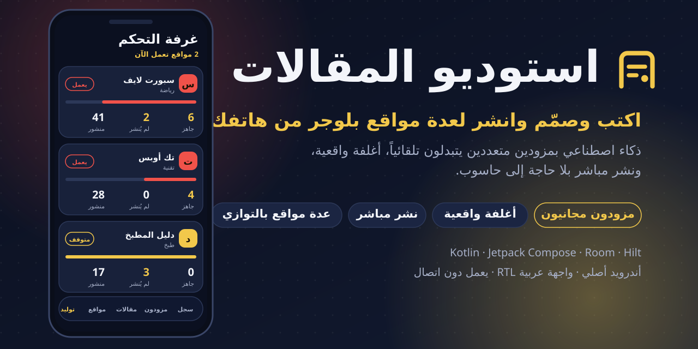
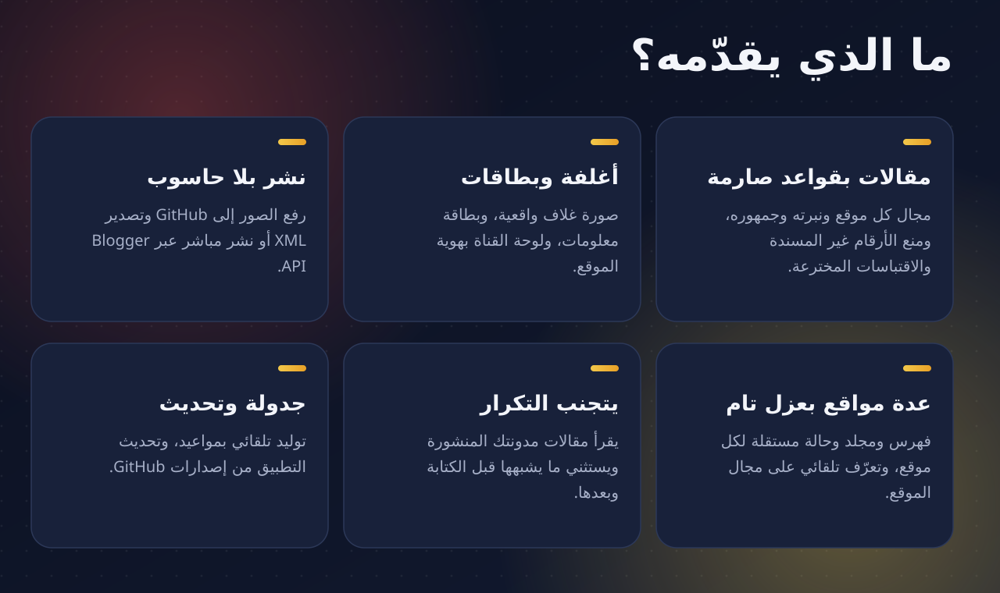
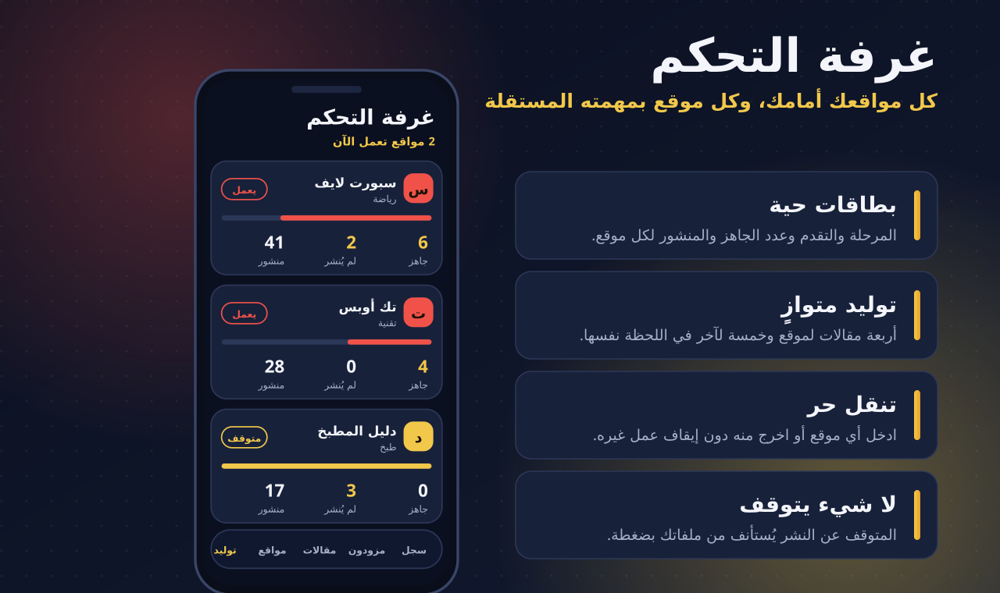
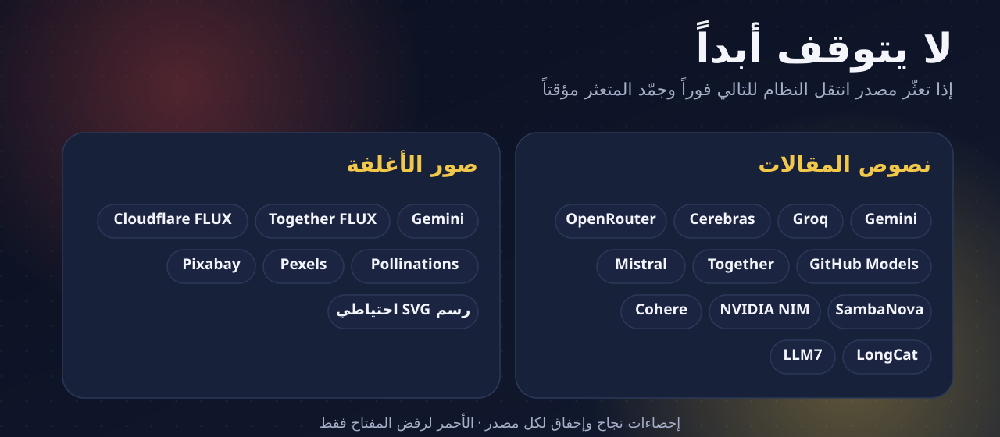

**اكتب · صمّم · انشر — من هاتفك**

▶ [الفيديو التعريفي (دقيقة، بصوت عربي)](docs/media/promo.mp4)

## الفكرة
تطبيق Android أصلي يدير عدة مواقع بلوجر من الهاتف: يولّد المقالات والأغلفة بالذكاء الاصطناعي، يصدّرها، ويرفع الصور وينشر مباشرة، دون حاسوب.

## غرفة التحكم
الشاشة الرئيسية تعرض كل المواقع معاً: تقدّم كل موقع، عدد الجاهز والمنشور، وتشغيل أكثر من موقع بالتوازي، كل موقع بمهامه المستقلة، مع حرية التنقل أثناء العمل.

## لا يتوقف أبداً
مزودو نص وصور متعددون بتبديل تلقائي: عند التعثّر أو انتهاء الحصة يُجمَّد المصدر مؤقتاً ويُستكمل العمل بالتالي، وآخر الحلقة رسم SVG محلي مضمون.

## المعمارية

## القدرات
- **توليد المقالات:** مجال كل موقع، أرقام موثّقة، منع الاقتباسات المخترعة والتكرار.
- **الأغلفة:** صور واقعية من مصادر متعددة، وبطاقات معلومات بهوية كل موقع.
- **التوازي:** عدة مواقع في وقت واحد بحالة مستقلة لكل موقع.
- **التصدير والنشر:** XML لبلوجر، رفع الصور إلى GitHub، نشر عبر Blogger API، واستكمال المنشورات المتوقفة بزر واحد.
- **العمل دون اتصال:** كل طلب شبكة محمي بإعادة محاولة وبديل آمن.
- **عربي RTL بالكامل** مع أرقام جدولية وأيقونات متجهة مرسومة يدوياً.

## التقنيات
Kotlin · Jetpack Compose · Hilt + KSP · Room (ترحيلات مرقّمة) · OkHttp · kotlinx.serialization · GitHub Actions.

## مواد للنشر
صورة جاهزة لإنستغرام وفيسبوك (1080×1350): [`docs/media/social-card.png`](docs/media/social-card.png)

## البناء والتوقيع
كل push يبني APK عبر `build.yml`. لنشر Release موقّع أضف في Settings ← Secrets and variables ← Actions: `KEYSTORE_BASE64` و`SIGNING_STORE_PASSWORD` و`SIGNING_KEY_ALIAS` و`SIGNING_KEY_PASSWORD`؛ بدونها يُبنى APK بمفتاح مؤقت بلا Release.

## بنية المستودع
- `app/` تطبيق Android · `docs/` الخريطة وملاحظات الإصدارات والوسائط
- `tools/media/` يولّد صور SVG: `python3 build_svgs.py`
- `tools/promo/` الفيديو: `render.py` (إطارات) ثم `voice.py` (صوت Gemini TTS من متغير `GEMINI_API_KEY`) ثم `mux.py`
- القواعد في `CLAUDE.md` والخريطة في `docs/repo-map.md`
